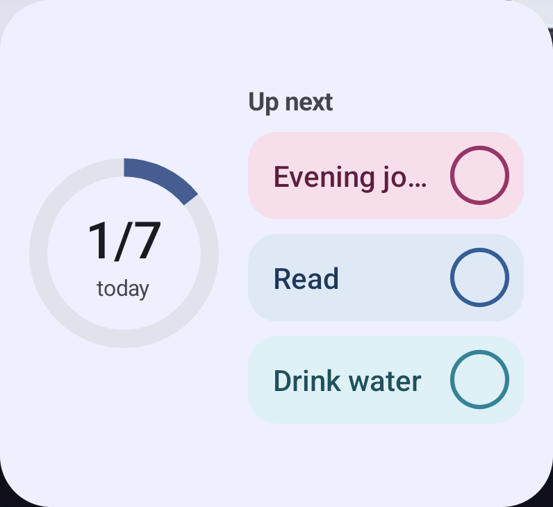
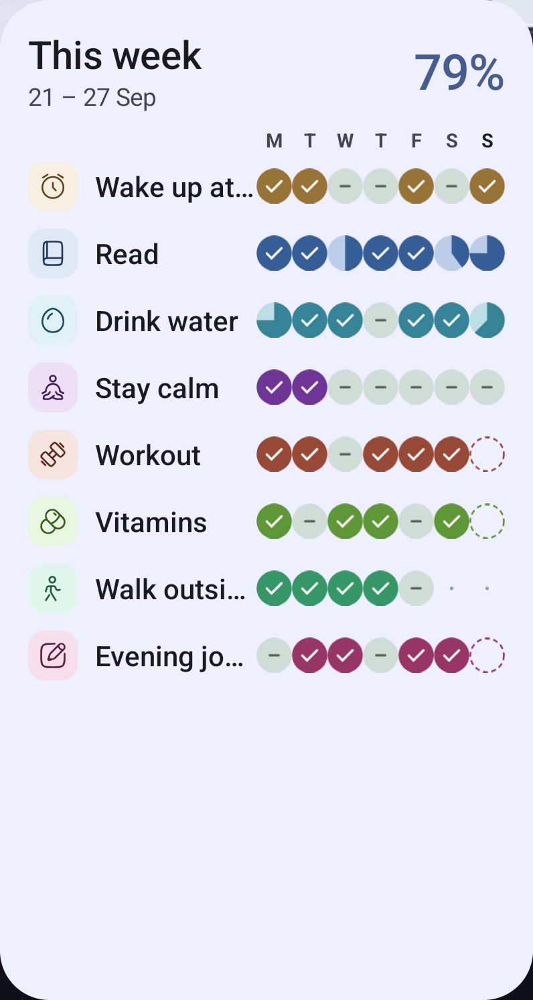
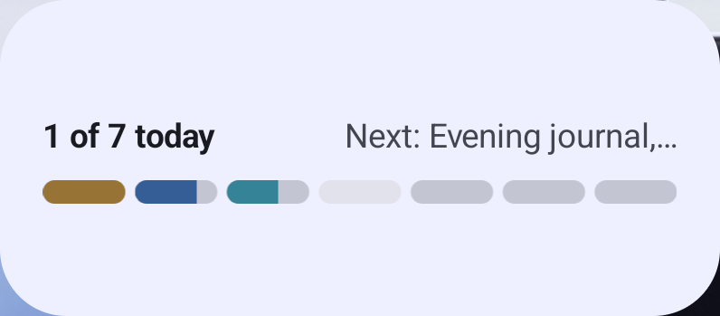
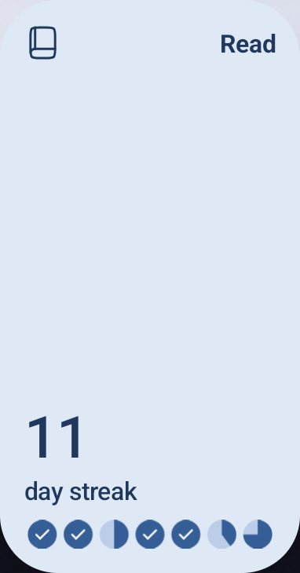

# Features

What Weft does today, and where each part lives in the code. Paths are under `app/src/main/java/app/sprout/habits/`.

## Today

The home screen shows the date, a score card for today, and every habit scheduled for today.

A habit card has four looks: open (an empty circle), done (filled with the habit's color and a check), partial (filled as far as the amount goes, with a ring showing the percentage) and skipped (dimmed). Swipe right to mark it done, swipe left to skip it (a swipe has to drag the card past half its width, so scrolling never logs a habit), tap the circle to toggle done, and press and hold to log an amount, pick an outcome and add a note. Each change can be undone from the snackbar. Swiping the opposite way also undoes: swipe left on a done habit or right on a skipped one to clear it. The press-and-hold sheet has an Undo button when the day already has an entry. A done check-off card shows when it was logged ("Done at 6:52 AM"). Skipping a habit that asks for a note opens the sheet with the cursor in the note field.

Code: `ui/today/`, scoring in `domain/Scoring.kt`.

Every tab starts with the same header (`ui/components/TabHeader.kt`): the title, the date or date range under it, and 48 dp round buttons on the right. Other screens use the same round buttons (`HeaderIconButton`) for back, close, edit, archive and delete.

## Sample data

First run is Get started (`ui/WelcomeScreen.kt`, after Burrow's): a pitch page with a panel of what Weft looks like in use, then two steps with dots on top. Step 1 picks habits: five suggestions (Wake up at 7, Read, Drink water, Workout, Evening journal), plus your own: the last row, "Add your own habit", opens a sheet with the Name field from New habit. Step 2 is a practice card (the real Today card and amount sheet, nothing saved) that ticks off swipe right, swipe left, tap the circle, press and hold (log part of it as Partial), Undo (every change shows Today's Undo bar) and add a note; a note written in the amount sheet then shows as a Journal note card, so you see where notes are kept. "Go to Today" saves: picked habits replace the sample habits; "Skip for now" keeps the sample habits and their banner.

A fresh install starts with eight sample habits (from the designs), two weeks of history and notes on several days, in the app language (`data/SampleData.kt`). They're added only on the very first launch, never on an update or after a restore. A card on Today removes them (only the sample habits, with their entries and notes); their ids are kept in DataStore (`sampleHabitIds`). The card goes for good the first time you log or change a habit (`sampleBannerHidden`); after that the sample habits are deleted like any other habit. Sample habits have reminders only in debug builds.

## Habits

Habits are created and edited on one screen: name, icon (7 suggestions, or any of 29 in a searchable sheet), color, how it's tracked (Check off, or Measure: a target in any unit, like 20 pages, 8000 steps, 45 min or 7 h), the days it's scheduled, a reminder, whether to ask for a note after a skip, and whether it appears on widgets. Manage habits lets you drag to reorder, archive, restore and delete.

Measure habits have a step: how far − / + and the slider move when logging (1 page, 500 steps, 0.25 h). Before 1.1 there was a separate Duration type; the database migration and backup import turn those habits into Measure habits in "min" (step 5) or "h" (step 0.25).

The Habits tab has a Week view (seven day marks per habit, with arrows to earlier weeks; tap any past day to edit it in the same sheet as Today) and an Overall view (a 26-week heatmap per habit with its current and best streak). Tapping a habit opens its detail screen (round back, edit, archive and delete buttons in the header) with the days done this month, best streak, note count, a month calendar (tap a past day to edit it) and its notes.

Code: `ui/edit/`, `ui/manage/`, `ui/habits/`, `ui/detail/`, statistics in `domain/Stats.kt`.

## Journal and notes

A note belongs to one habit and one day. The Journal tab lists notes newest first, grouped by day; each note shows the habit, that day's outcome and the time it was written ("written Thu, 11:28 PM" when that was a later day), and the text. It opens on all notes. The two buttons at the top open bottom sheets to pick dates or one or more habits; while one is on, it shows as a chip under the title, and its ✕ clears it. When nothing matches, the Journal says which filter is hiding the notes and offers "Show all notes". A button whose filter is on is tinted and gets a small dot. When you write a new note for a habit and day that already have one, that note opens so you add to it. Notes can be added from Today, the Journal, a habit's detail screen or the press-and-hold sheet, and edited or deleted later. While you write, New note offers suggestions, worked out on the phone from a fixed list of starter phrases and your own notes (nothing is sent anywhere): before typing, "Quick start" phrases for the day's outcome (with the openers you use most) and "Your recent notes" for the habit; while typing, the rest of a sentence you wrote before in muted text after the cursor, "Finish with" endings and "Similar notes". The placeholder asks a question that fits the day ("What got in the way?" after a skip). More → Journal turns suggestions off or clears what they learned; the notes stay. Press and hold a note card in the Journal for a sheet with Edit note, Share and Delete note; deleting shows an Undo snackbar.

Code: `ui/journal/`, `ui/note/`.

## Insights

A summary for a range of dates: this week by default (a selected "This week" chip under the title), or any range from the calendar button (it takes the chip's place, with ✕ to go back to this week), for all habits or the ones you pick. It shows the average score with a bar per habit and the done and partial counts; a Patterns card with the weekday that goes best and the habit that dropped most against the range before; a bar per weekday (one per week for ranges over two weeks); and a row per habit with its days kept and a score ring, sorted by score or by streak (the ring then shows the streak within the chosen dates). Tapping a bar shows its numbers, and tapping a habit opens it. A past day with no entry counts as 0 in the score; only a day marked Skip is left out.

Code: `ui/insights/`.

## Reminders

Each habit can have one daily reminder on its scheduled days, as a **notification** or an **alarm** (1.6.0). Tapping New habit's Reminder card opens one sheet: the time (the one time wheel, the same as Burrow's: hour, minute in 5s, AM/PM over a pill band; `ui/components/TimePickerSheet.kt`), then Notification ("A quiet nudge in your notifications") or Alarm ("Rings full screen until you act"), then Set reminder.

A notification shows what's left for today and has buttons: Done and Snooze 10 min; a measured habit gets +step (e.g. "+5 pages", and the line updates to what's left). Logging from a notification counts like logging in the app, and Today offers Undo the next time it opens. An alarm rings with the alarm sound until answered, over the lock screen: slide to mark done, Snooze 10 min, or Dismiss; the power or a volume button silences it. Unanswered, it stops after 10 minutes and leaves a "missed at" notification. While the phone is in use, or when Android 14+ doesn't allow full-screen alarms, it rings as a notification with the same three buttons. A habit already Done or Skip today gets no reminder and no alarm; a Partial one still does. Reminders are exact when "Alarms & reminders" is allowed, otherwise within 10 minutes; an alarm needs it, and the sheet says so. At 9 PM, habits that were skipped and ask for a note get a prompt with Add note (opens New note for that day) and Done.

Code: `notify/`, `ui/alarm/`, timing in `domain/ReminderTime.kt`.

## Widgets

Four home-screen widgets: This week (every habit with its week), Today (a progress ring and the next habits, with a circle to mark each done), Today strip (a slim bar per habit), and Streak (one habit's current streak and last seven days). They follow the phone's colors (wallpaper colors on Android 12+) and its light or dark mode, whatever the app's own theme is set to. They update after every change made in the app or on a widget, and show a light placeholder while loading instead of a blank box.

| Today | This week | Today strip | Streak |
| --- | --- | --- | --- |
|  |  |  |  |

Code: `widget/`.

## Backup

Everything, including preferences, can be exported to a JSON file and imported again through the system file picker. The app needs no storage permission. A CSV export opens in any spreadsheet.

Since 1.5.0 backup has its own screen: More → **Backups** opens **Backup & restore**, which starts with a card showing the last backup and the one action that matters (Back up now, Try again, Connect Google Drive, or Export now in the F-Droid build). The Google Play and GitHub builds can also back up to the user's own Google Drive: Connect an account, then Back up now, a schedule (every night while charging, weekly, monthly or off; Wi-Fi only by default) and Restore from any of the last 10 backups. The files sit in Drive's hidden app folder, which only Weft can see. Details and edge cases: [`DRIVE-BACKUP.md`](DRIVE-BACKUP.md). The F-Droid build has no Drive.

Code: `data/backup/`, `ui/more/BackupRestoreScreen.kt`, `ui/more/BackupSection.kt`, `ui/more/DriveSection.kt`, `src/drive/`.

## Settings

The More tab covers backup, the app language (English, Hindi, Spanish, German, French, Portuguese (Brazil), Japanese or the phone's language, applied at once), theme (system, light, dark), dynamic color or an accent color, font (a sheet like Language: Lexend, system, Space Grotesk, Outfit, Atkinson Hyperlegible, each shown in itself), text size, the first day of the week, the default reminder time, notification settings and About.

Code: `ui/more/`, `data/SettingsRepository.kt`, `ui/theme/`, `AppLanguage.kt`; text in `res/values*/strings.xml`.

## Shortcuts and links

Long-press Weft's icon for **Add note** and **New habit** (1.5.0). `weft://` links open a tab (`weft://today`, `habits`, `journal`, `insights`, `more`), New note (`weft://note/new`), New habit (`weft://habit/new`) or a habit's page (`weft://habit/<id>`); they never change data. `sprout://` (the name before the rename to Weft) works the same. Widgets and notifications use the same path, so a habit that was deleted opens nothing.

Code: `ui/nav/AppLink.kt`, `res/xml/shortcuts.xml`.

## Updates

The GitHub build checks GitHub Releases for a newer version: from About → Check for updates, and on its own at most once a day. A newer version shows the Update available dialog with up to five What's new lines from the release notes; Update downloads the APK with progress, checks it against the release's SHA256SUMS.txt and opens Android's installer (Android asks once to allow installs from Weft). Later hides that version until the next one. More → About Weft shows an "Update available" pill. The update dialog and the support prompt never show on the same launch. The F-Droid build has no checker; F-Droid updates it. The Play build (1.5.0) uses Google Play's In-App Updates: About → Check for updates asks Play and opens Play's update screen, and the same check runs once a day on launch; a version the user backed out of isn't offered again.

Code: `data/update/UpdateManager.kt`, `ui/update/UpdateUi.kt`, `domain/Versions.kt`, `src/play/.../PlayUpdates.kt`; the permission and FileProvider are in `src/github/AndroidManifest.xml`.

## Support

About ends with the developer, mid apps (its mark, and "Contact: hello.midapps@gmail.com"; tapping writes an email), above "Made by Nisab Mohd & Contributors". It has a Sponsor link (not in the `play` build, where Google Play's payments policy rules it out; the support prompt drops its Sponsor button there too) and, in the `play` build once it is listed (`PLAY_LISTED`), a Rate on Play Store link; the support prompt offers the same button, which shows Google Play's in-app rating card (1.5.0) and falls back to the store page. The `foss` and `github` builds never link to Google Play. After a week of use and 30 check-ins, Weft asks once whether you'd like to support it; it asks again after 60 days at most, and stops after two "Maybe later"s.

Code: `support/`, `ui/about/`.
